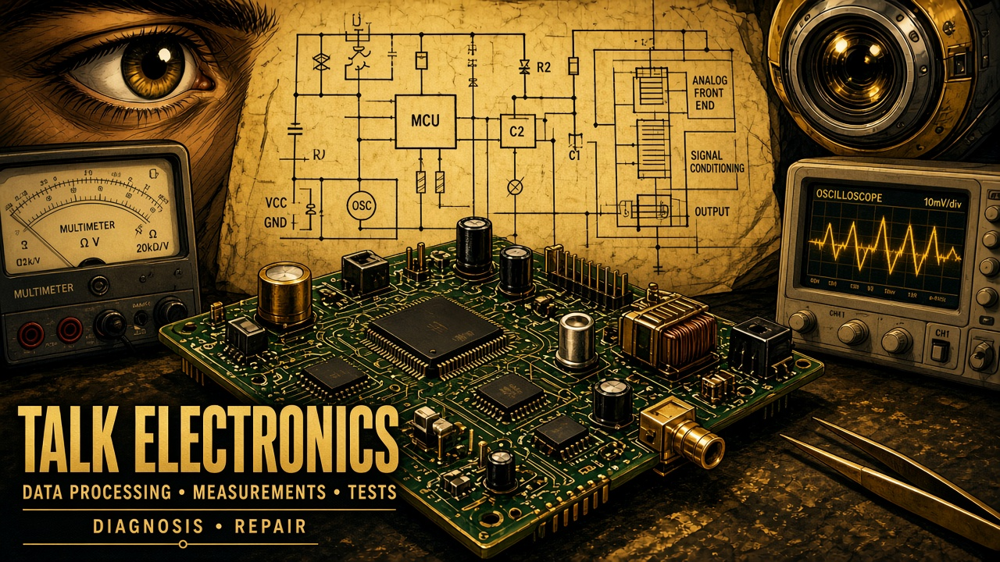
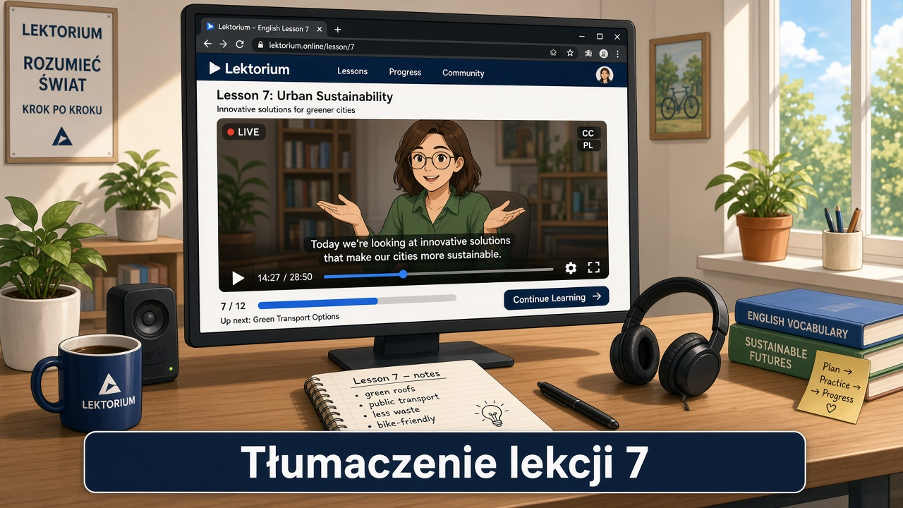

---
hide:
  - toc
  - navigation
---

### :fontawesome-solid-bolt: Talk Electronics

**Electronic schematic analysis in the browser**

Web app: extract symbols from PDF/PNG schematics, build a netlist, and support diagnostics and repair.

[:octicons-arrow-right-24: View project](Talk_electronics/index.md){ .md-button .md-button--primary }

[Goal - help with repairs]

### :fontawesome-solid-microphone: Protokolant

**Recording → text → protocol on your PC**

Desktop app: record a meeting, transcribe, and produce a short summary.

[:octicons-arrow-right-24: Polish page](Protokolant/index.md){ .md-button .md-button--primary }

[Goal - help with meetings]

### :fontawesome-solid-book-open: Lektorium

**EN lesson → Polish captions or lector**

Desktop app: translates and generates Polish captions or a lector voice for a lesson.

[:octicons-arrow-right-24: Polish page](Lektorium/index.md){ .md-button .md-button--primary }

[Goal - help with learning]

 :fontawesome-brands-github: [GitHub](https://github.com/robetr286) · :fontawesome-brands-linkedin: [LinkedIn](https://linkedin.com) · <a href="mailto:robetr@wp.pl" title="robetr@wp.pl" aria-label="robetr@wp.pl">:fontawesome-solid-envelope:</a> Contact

