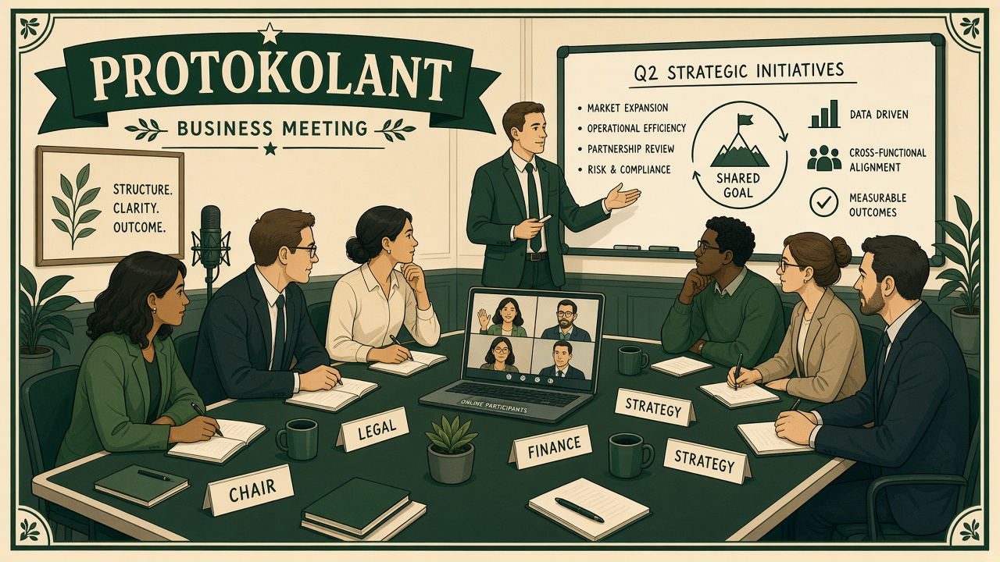
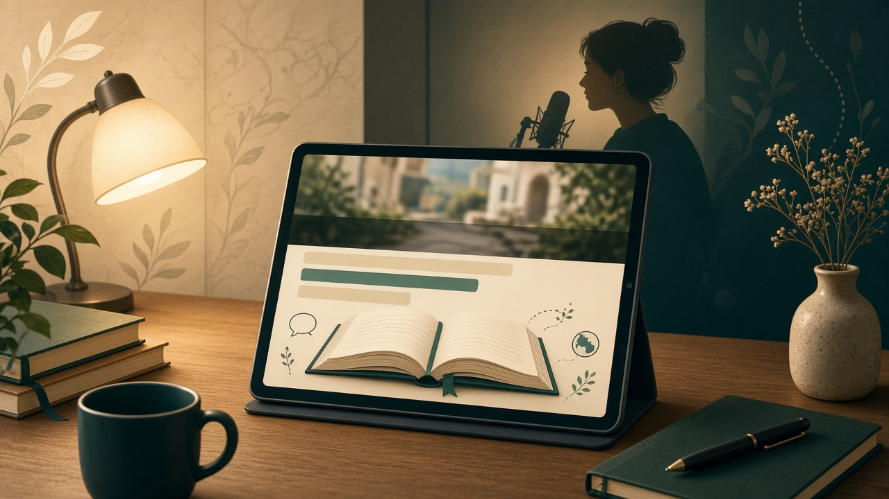

---
hide:
  - toc
  - navigation
---

### :fontawesome-solid-bolt: Talk Electronics

**Analiza schematów elektronicznych w przeglądarce**

Aplikacja webowa: z PDF/PNG schematu wyciąga symbole, buduje netlistę i wspiera diagnostykę i naprawę.

[:octicons-arrow-right-24: Zobacz projekt](Talk_electronics/index.md){ .md-button .md-button--primary }

[Cel - pomóc w naprawie]

### :fontawesome-solid-microphone: Protokolant

**Nagranie → tekst → protokół na Twoim PC**

Lokalna aplikacja na komputer: nagrywa spotkanie, robi transkrypcję i krótkie streszczenie.

[:octicons-arrow-right-24: Zobacz projekt](Protokolant/index.md){ .md-button .md-button--primary }

[Cel - pomóc w spotkaniach]

### :fontawesome-solid-book-open: Lektorium

**Lekcja EN → polskie napisy lub lektor**

Aplikacja na komputer: tłumaczy i generuje napisy polskie lub lektora do lekcji.

[:octicons-arrow-right-24: Zobacz projekt](Lektorium/index.md){ .md-button .md-button--primary }

[Cel - pomóc w nauce]

 :fontawesome-brands-github: [GitHub](https://github.com/robetr286) · :fontawesome-brands-linkedin: [LinkedIn](https://linkedin.com) · <a href="mailto:robetr@wp.pl" title="robetr@wp.pl" aria-label="robetr@wp.pl">:fontawesome-solid-envelope:</a> Kontakt

